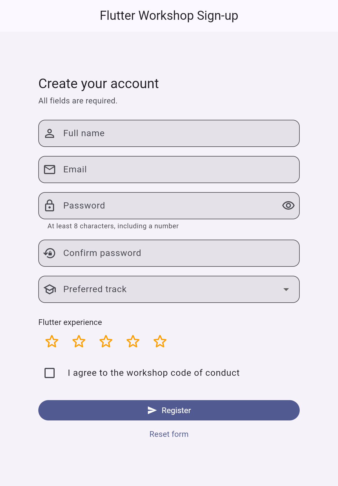

# FormField Widget Presentation

**`FormField`** is the Flutter widget that gives any input (text, dropdown, checkbox, even a star rating) validation, saving and resetting, all handled together by its parent `Form`.

This app is a workshop sign-up form I built to show `FormField` in a realistic setting. It uses the built-in subclasses (`TextFormField`, `DropdownButtonFormField`) alongside two custom fields made straight from `FormField<T>`.

<p align="center">
  
</p>

## How to run it

You need the [Flutter SDK](https://docs.flutter.dev/get-started/install) (Dart 3.12 or newer).

```bash
git clone https://github.com/annie-bw/formfield-widget-presentation.git
cd formfield-widget-presentation
flutter pub get
flutter run            # choose a device, or add: -d chrome
```

To run the test:

```bash
flutter test
```

## The three attributes

All of the code is in [`lib/main.dart`](lib/main.dart).

### 1. `validator`
A function that receives the field's current value and returns an error message (`String`), or `null` if the value is fine. The field doesn't run it by itself. It runs when `Form.validate()` is called, and the message shows up under that field.

In the app:
- **Email** is checked against a simple regex.
- **Confirm password** compares its value with the password controller (cross-field validation).
- **Star rating** fails if it's still `0`.

### 2. `onSaved`
A callback that receives the field's final value when `Form.save()` is called. I only call `save()` after `validate()` returns `true`, so every value that reaches `onSaved` is already valid. Each field writes its value into the page's state, and the summary dialog reads from there. This keeps the "read the data" step separate from the "check the data" step.

### 3. `autovalidateMode`
Controls *when* validators run on their own:
- `disabled`: only when `validate()` is called.
- `onUserInteraction`: after the user changes the field.
- `always`: on every rebuild.

The form starts as `disabled` so nobody sees red errors before typing anything. After the first failed submit it switches to `onUserInteraction`, so errors clear as soon as they're fixed. Pressing **Reset form** sets it back to `disabled`.

## Things to try in the demo

1. Press **Register** with everything empty. Every field shows its error at once.
2. Fill the fields in one at a time. Each error disappears as you fix it.
3. Type two different passwords to see the "Passwords do not match" error.
4. Fill everything in correctly and press **Register** to see the summary dialog with the saved values.
5. Press **Reset form** to clear every field, including the custom ones, back to its initial value.
